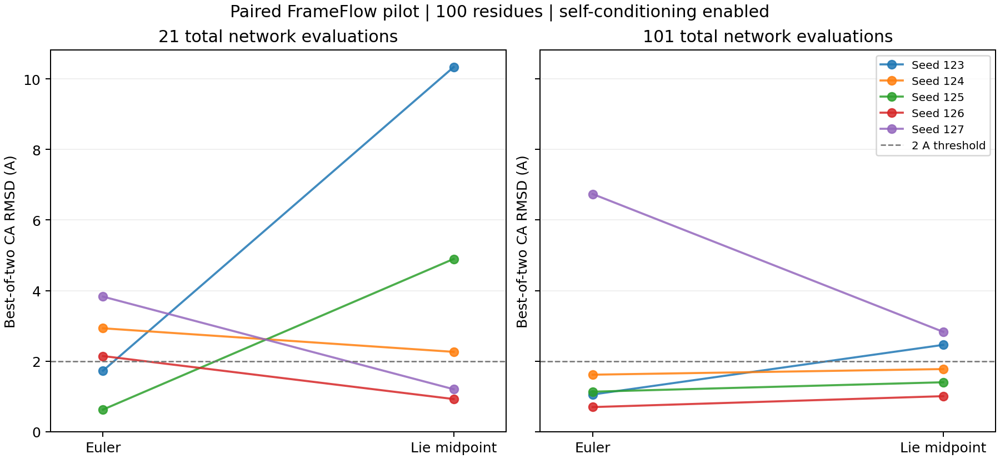
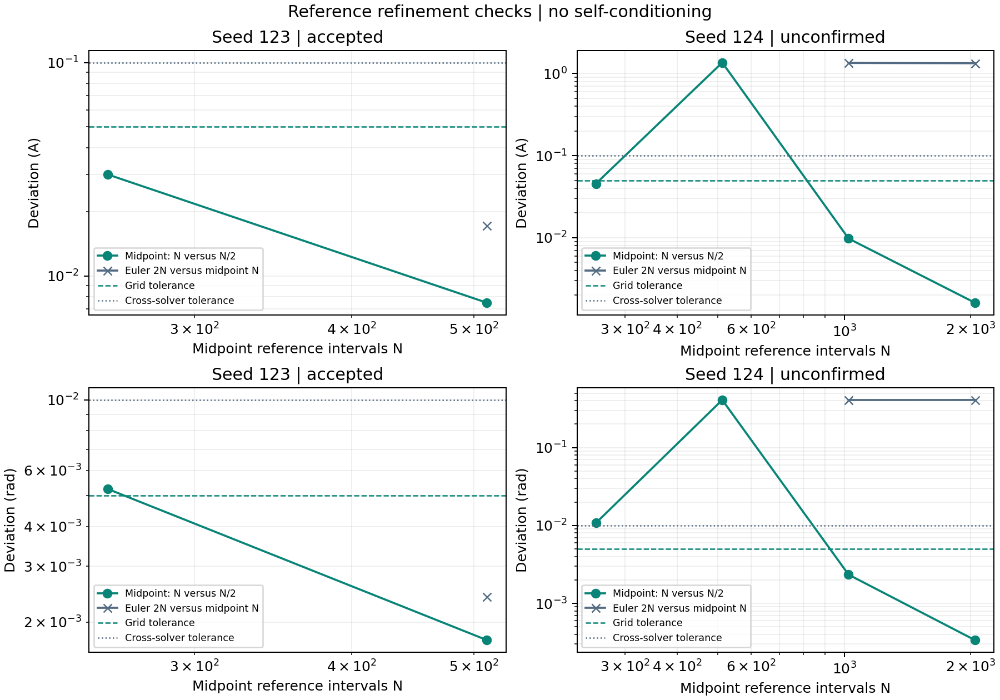
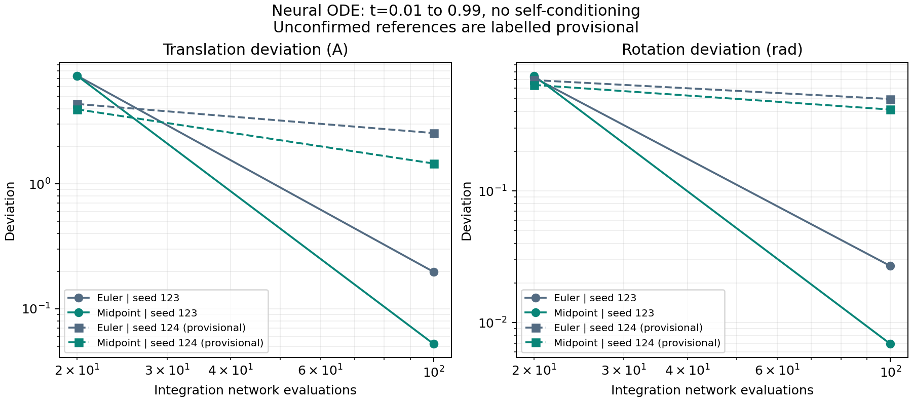

# Detailed methods and recorded results

Pilot run on 7 October 2026, using a local NVIDIA GTX 1650 Ti (4 GB) for backbone
generation and ProteinMPNN. Structure prediction was completed through the ESM Atlas public API.
Its completion status is reported below.

## Question and scope

At equal network-evaluation cost, does Lie midpoint improve backbone
self-consistency compared with Euler? We also measure numerical deviation on a
separate memoryless neural ODE, where a refined reference can be meaningful.
The midpoint method is a standard numerical method, not a newly invented solver.

This compares integration of one fixed published FrameFlow checkpoint. It does
not compare training objectives or establish a general diffusion/flow ranking.
Five initial states per configuration make this a descriptive pilot, not a
statistically conclusive benchmark.

## Fixed protocol

- Length: 100 residues. Seeds: 123, 124, 125, 126, 127.
- Exact initial translation/rotation tensors are shared within each pair.
- FrameFlow integration is deterministic given the initial state and checkpoint;
  this experiment uses ODE solvers without Brownian noise increments.
- Budgets: 21 and 101 total network evaluations, including one final prediction.
  Euler uses 20/100 intervals; midpoint uses 10/50 intervals.
- Self-conditioning is enabled for the quality experiment. Midpoint freezes
  its history during both stages and updates it from the midpoint prediction.
- The final prediction explicitly supplies time 1 to both solvers. This differs
  from an upstream final-call detail documented in the earlier verification.
  Thus Euler here is a controlled baseline, not bit-identical upstream inference.
- ProteinMPNN: v_48_020, temperature 0.1, two sequences, seed 38 restarted for
  every backbone. The original polyalanine sequence is excluded.
- ESMFold: same public endpoint for every sequence. Raw responses, titles,
  timestamps, hashes, attempts and failures are preserved.
- Primary score: minimum full-residue CA RMSD among the two predictions, after
  a proper Kabsch fit. Success threshold: scRMSD < 2 A.
- TM-score is calculated by TM-align and normalized by backbone length.
  The best TM-score can come from a different sequence than the best RMSD.

The protocol was saved before generation in `protocol.json`. Generation and
design do not filter candidates by quality. Paired results match seed AND budget.
Seed 123 was already used in the verification milestone; seeds 124--127 are new.
This pilot is therefore not a fully blind held-out evaluation.

## Quality results

Completed backbones: 20/20.
Successful predicted structures: 40/40.

Basic geometry diagnostics: 20/20 backbones have no adjacent CA distances above 4.5 A, no distinct CA pairs below 1.5 A, and no peptide C--N distances above 2 A. These coarse checks are separate from self-consistency scores.

| Total network calls | Method | scRMSD < 2 A | Median scRMSD (A) | Mean scRMSD (A) | Median scTM | Median generation time (s) |
|---:|---|---:|---:|---:|---:|---:|
| 21 | euler | 2/5 | 2.147 | 2.255 | 0.803 | 2.03 |
| 21 | midpoint | 2/5 | 2.265 | 3.926 | 0.850 | 2.10 |
| 101 | euler | 4/5 | 1.137 | 2.250 | 0.929 | 9.84 |
| 101 | midpoint | 3/5 | 1.778 | 1.897 | 0.888 | 9.90 |

- Budget 21: midpoint has lower scRMSD in 3/5 pairs; median paired difference (midpoint minus Euler) is -0.668 A.
- Budget 101: midpoint has lower scRMSD in 1/5 pairs; median paired difference (midpoint minus Euler) is 0.267 A.

The pilot shows mixed outcomes across seeds and metrics. It does not establish a systematic quality improvement from midpoint. Means and medians are both reported because poor individual backbones can influence the mean strongly.

Positive paired RMSD differences mean midpoint is worse. These counts refer
only to this sample of initial states; a fraction out of five is highly uncertain.
Reported generation timings exclude setup, model loading, sequence design and
folding. Methods run sequentially, receive warmups, and alternate execution order.

## Numerical error study: a separate experiment

This study uses seeds 123 and 124 with **self-conditioning disabled**. Both
methods then evaluate the same memoryless neural vector field. We integrate
from t=0.01 to t=0.99, avoiding the translation field's singular denominator at
t=1. Errors are measured before any final clean prediction and without rigid
alignment: translation RMS distance in A and rotation RMS geodesic angle in rad.

The state is represented with FrameFlow's product metric on SO(3)^L x R^(3L),
not a coupled rigid-body twist exponential. Both numerical solvers use the
tested rotation exponential; Euler generation above retains upstream arithmetic.

We refine midpoint from 128 intervals by doubling, up to 2048 if needed. Grid
agreement tolerances are 0.05 A and 0.005 rad. When these pass, an Euler run with
twice as many intervals supplies an independent solver check, with tolerances
0.10 A and 0.01 rad. A reference is accepted only if both checks pass.

- Seed 123: midpoint reference uses 512 intervals; agreement with the previous grid is 0.0075 A / 0.00176 rad. Euler cross-check deviation: 0.0172 A / 0.00241 rad. Reference accepted: **True**.
- Seed 124: midpoint reference uses 2048 intervals; agreement with the previous grid is 0.0016 A / 0.00034 rad. Euler cross-check deviation: 1.3361 A / 0.40848 rad. Reference accepted: **False**.

Completed numerical cases: 2/2.
All planned references confirmed: **False**.
These are empirical reference checks in float32, not a proof of exactness.
If a reference is unconfirmed, its reported deviations are provisional and
must not be interpreted as established discretization errors.

| Seed | Integration network calls | Method | Translation deviation (A) | Rotation deviation (rad) |
|---:|---:|---|---:|---:|
| 123 | 20 | euler | 7.3360 | 0.72239 |
| 123 | 20 | midpoint | 7.3262 | 0.74686 |
| 123 | 100 | euler | 0.1976 | 0.02695 |
| 123 | 100 | midpoint | 0.0524 | 0.00691 |
| 124 | 20 | euler | 4.3606 | 0.69174 |
| 124 | 20 | midpoint | 3.9478 | 0.63631 |
| 124 | 100 | euler | 2.5506 | 0.49742 |
| 124 | 100 | midpoint | 1.4559 | 0.41386 |

This numerical study and the quality experiment have different self-conditioning
and terminal-time settings. Their scores answer different questions; they should
not be pooled or treated as numerical and biological errors of the same trajectory.
An integrator's formal order on a smooth ODE does not automatically transfer to
a sampler with a changing prediction history.

## Interpretation limits

- Seed 123 at 100 integration calls: translation deviation is 0.1976 A for Euler and 0.0524 A for midpoint. This is a case-specific numerical comparison against an accepted empirical reference.
- Seed 124: the reference failed the predefined checks. Do not use its provisional deviations to rank the solvers. The cause has not been diagnosed; investigate this disagreement before expanding the numerical benchmark.

- Self-consistency is an in-silico proxy, not experimental folding or function.
- The API identifies ESMFold V1 but does not expose checkpoint hash, recycle
  settings or server hardware. A final reproducible benchmark should pin these.
- Two designed sequences provide limited search per backbone. Keep this count
  equal across methods and report it with every success rate.
- The true RMSD here is sqrt(mean(squared distances)). Related upstream code
  labels a mean distance as RMSD; both values are exported for transparency.
- Continuous scores, all initial states and failures are retained. Numerical
  accuracy alone does not imply better protein geometry or self-consistency.

## Execution

Use the portable commands in [SETUP.md](SETUP.md). The executable code is in `scripts/`; all pilot data is in `results/pilot/`.
