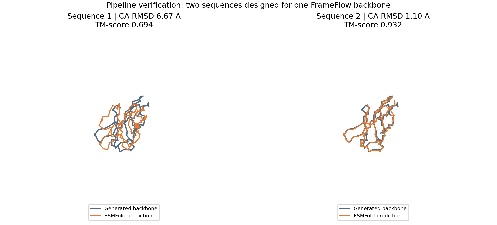
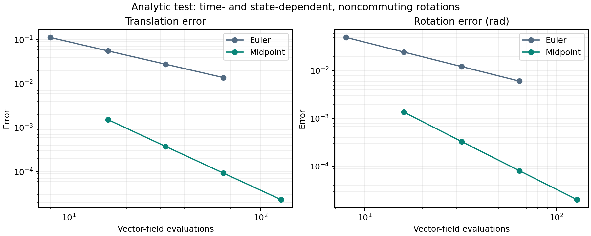

# Pipeline and integrator verification

Completed on 7 October 2026. This is a verification milestone, not a statistical
comparison of protein generation methods.

## What was verified

1. One existing FrameFlow backbone was used to design two real amino-acid
   sequences with ProteinMPNN.
2. Both sequences were folded through the documented public ESM Atlas endpoint,
   after the user explicitly authorized their submission.
3. Both predictions were parsed, checked against their input sequence, aligned
   to the source backbone and scored.
4. An explicit Lie midpoint integrator passed analytic numerical tests.
5. The integrator executed the original FrameFlow network on the local GPU.
6. An Euler adapter reproduced the original sampler on the same initial tensors.

## Sequence design and refolding

Source: the stage-2 FrameFlow backbone, length 100, generation seed 123.
An identical copy is included as `pipeline/backbone.pdb`.

ProteinMPNN used checkpoint `v_48_020`, temperature 0.1, seed 38, two sequences
and batch size one. The original polyalanine entry was excluded from folding.
The network was run locally with the ProteinMPNN code bundled in FrameDiff.
Windows fixes: explicitly select GPU 0 and pass the PDB path with forward slashes.
No neural-network weights or inference equations were modified.

| Designed sequence | CA RMSD (angstrom) | TM-score | RMSD below 2 angstrom |
|---|---:|---:|---|
| 1 | 6.672 | 0.694 | No |
| 2 | 1.099 | 0.932 | Yes |

Best-over-two scRMSD: **1.099 angstrom**.
Best-over-two scTM: **0.932**.
The backbone passes this computational self-consistency criterion with sequence 2.
This is not experimental validation of physical folding or function.



### Metric definitions and checks

- RMSD is `sqrt(mean(squared distances))` over all 100 corresponding CA atoms
  after a proper Kabsch fit. Reflections are excluded.
- An independent BioPython fit agrees with this calculation to below 1e-8 A.
- A rigidly transformed control returns RMSD 7.68e-15 A.
- TM-score uses TM-align via tmtools 0.2.0 and reports both chain normalizations.
  Both chains have length 100. The candidate sequence is supplied for both;
  the source PDB's ALA labels are placeholders.
- The related FrameDiff `calc_aligned_rmsd` implementation returns mean Euclidean
  distance after fitting, despite its name. Both true RMSD and mean distance are
  exported here to make this distinction explicit. They are not interchangeable.
- ESM Atlas writes confidence in the PDB B-factor column on a 0..1 scale in these
  responses. Raw CA means are 0.5827 and 0.8449. These are auxiliary values.

### Folding backend limitation

The two requests returned HTTP 200 with PDB atom records. Their headers identify
ESMFold V1. Raw responses, sequence hashes, PDB hashes and request timings are
saved in `pipeline/folding`. The service does not expose a verified checkpoint
hash, recycle count or server hardware. Thus this verifies the pipeline, while
an eventual benchmark should pin a folding checkpoint and settings on a suitable
GPU (for example a Colab runtime). No local ESMFold prediction was performed.

## The new integrator

We integrate the FrameFlow product representation `SO(3)^L x R^(3L)` with its
separate translation and rotation fields. This is not the coupled matrix SE(3)
exponential of rigid-body twist dynamics.

Convention: `R_dot = R hat(omega)`.

For midpoint, evaluate `(v1, w1)` at the start, form

```
x_half = x + (h/2) v1
R_half = R Exp((h/2) hat(w1))
```

Then evaluate `(v_half, w_half)` at `(t+h/2, x_half, R_half)` and take

```
x_next = x + h v_half
R_next = R Exp(h hat(w_half))
```

This uses two network evaluations per integration interval. A final clean-frame
prediction is also counted. Euler with 20 intervals and midpoint with 10 intervals
therefore both use **21 network evaluations**, not 20.

### Analytic tests

The exact reference uses SciPy rotations independently of the tested update.
It includes noncommuting axes, curved translation and state-dependent feedback.
Halving the step gives the expected asymptotic convergence:

| Method | Translation order | Rotation order |
|---|---:|---:|
| Euler | 1.004 | 1.004 |
| Lie midpoint | 2.006 | 2.010 |

Tests also cover rotation orthogonality, determinant +1, a constant field,
zero velocity, batched residues, and equivariance under a global rigid transform.
The SO(3) matrix constraint errors remain below 1e-11 in these float64 tests.



### FrameFlow smoke tests and protocol details

All runs share the exact saved `sampler/initial_state.pt`, with SHA-256 recorded
in each run. They use the same published PDB checkpoint from stage 2.
Every generated PDB contains one chain, 100 residues and all 400 backbone atoms
with finite coordinates. `sampler_checks.csv` records geometric diagnostics;
passing a numerical test does not guarantee good protein geometry or designability.
None of the newly generated midpoint or Euler smoke-test backbones was refolded.

- `euler_upstream`: faithful upstream terminal-time behavior; adapter versus
  original sampler unaligned CA RMSD is 1.595e-6 A before PDB rounding.
- `euler` and `midpoint`: same explicit endpoint time for the final prediction,
  21 evaluations each, self-conditioning enabled.
- `euler_no_sc` and `midpoint_no_sc`: same setup with self-conditioning disabled.

**Terminal-time detail:** the original sampler updates `t` to 1 in its final call
but leaves the network's `so3_t` and `r3_t` at the previous grid point. The network
uses those latter two fields. The adapter offers `--terminal-mode upstream` for
faithful reproduction and `--terminal-mode endpoint` to use time 1 consistently.
The default is endpoint; it is a documented protocol change, not an exact
reproduction of the published sampler. Solver comparisons must match this mode.

**Self-conditioning detail:** the network normally reuses its previous clean
translation prediction. The midpoint adapter freezes that history during its
two stages, then updates it from the midpoint prediction. Formal second-order
accuracy was verified for a smooth memoryless field, not for this full history-
dependent neural sampler. The no-self-conditioning mode separates these issues,
but it also changes the model's usual inference conditions. Both modes need to
be treated explicitly when planning the comparison.

These runs verify execution and accounting. They do not establish a quality or
speed advantage for midpoint. Some runs executed concurrently; their timings
are unsuitable for benchmarking.


## Current workflow

This folder is a historical snapshot. For portable execution, use
[setup](../../../docs/SETUP.md) and `scripts/project.py`.
